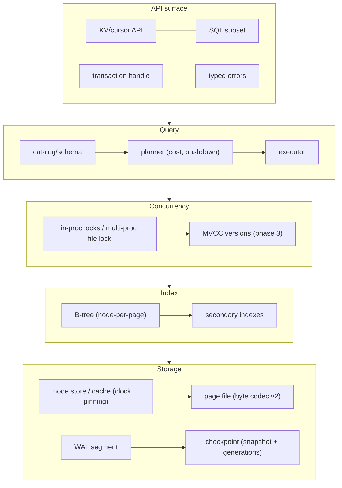
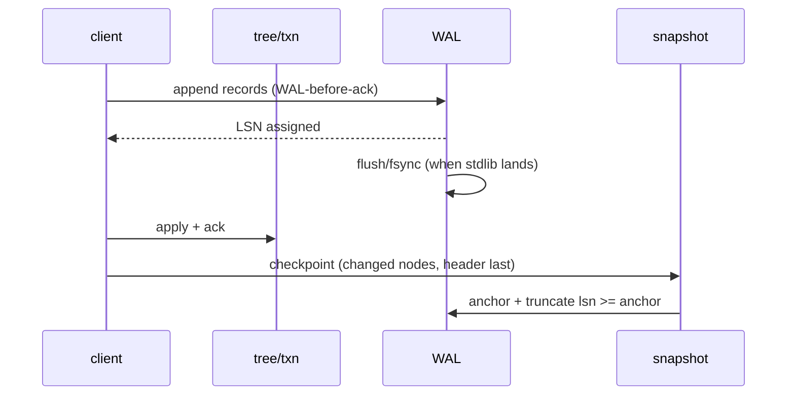
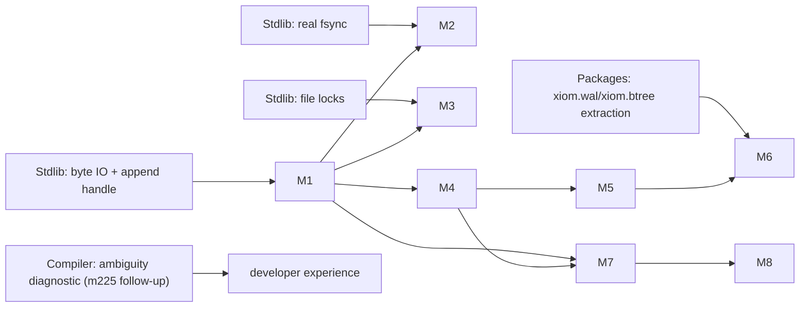

<!-- Copyright (c) 2026 Eleftherios Notas and The XIOM Authors -->
<!-- SPDX-License-Identifier: MIT OR Apache-2.0 -->
# ORBITDB Production Plan -- the XIOM flagship embedded database

> **Status:** 2026-10-09. This is the strategy; `docs/PRODUCTION-READINESS.md`
> is the measurement (scoreboard + changelog). Execution follows
> `docs/checklists/production-release.md`. Owner sets up the public release
> when the release signal (section 12) fires.

## 1. Mission

Build a **production-grade embedded database** -- fast, crash-safe, secure,
zero-dependency in its core -- and use it to harden the whole XIOM ecosystem
end to end: contracts, generics, FFI/bindings, packages, stdlib, and the
compiler. Every real workload ORBITDB runs becomes a stress test for XIOM;
every defect it finds is relayed, fixed, re-tested, and recorded.

One sentence: **ORBITDB is what SQLite is to C -- but for XIOM.**

Non-goals for 1.0: network server mode, replication/sharding, full SQL-92,
analytics columnar engine, cloud control plane. The core is an embeddable,
single-node, ACID engine; the server/daemon is layered later -- now planned
as the **Station** tier on top of the **Satellite** engine
(`docs/TWO-TIER-ARCHITECTURE.md`, owner directive 2026-10-16; 1.0 remains
the embedded Satellite).

## 2. Target profile

| Property | Target |
|---|---|
| Embedding | single process callable; multi-process safe via advisory locks |
| Model | ordered KV core + relational subset (catalog/schema, SELECT/INSERT/UPDATE/DELETE, WHERE/ORDER/LIMIT) |
| Transactions | ACID; single-writer + snapshot reads, then MVCC |
| Durability | WAL-before-ack, group commit + fsync, checksummed pages, power-loss recoverable |
| Recovery | torn-tail + torn-page tolerant; bounded replay (checkpoint) |
| Concurrency | in-process multi-reader/single-writer, then MVCC snapshots; multi-process via file locks |
| Performance | see section 10 targets; benchmark-driven, published numbers |
| Security | memory-safe core (XIOM), strict contracts, fuzz + fault injection in CI, no unsafe outside confinement |
| Packaging | `xiom.db` package, `xiom.wal`/`xiom.btree` extraction, C-ABI bindings |
| Compatibility | versioned on-disk formats with migration policy (`docs/FORMATS.md`) |

## 3. Architecture target

Layering rules (already the codebase's discipline): UI != logic != data;
contracts at every seam; the durable facade (`DBFile`) is the reference
implementation, the in-memory facade is a test double.

## 4. Durability model

1. **WAL-before-ack** (done): every write is logged before it is acked; the
   tree is applied after.
2. **Group commit + fsync** (blocked on stdlib): commit = append records,
   fsync the segment once per group, then ack. `wal_file_flush` /
   `page_file_sync` are the seams; no power-loss claim before this lands.
3. **Checkpoint = generations** (done): incremental node pages, header-last
   commit, uncommitted generations ignored, compaction at
   `node_count + 64`, anchor record keeps LSN continuity, never truncate to
   empty.
4. **Torn-page protection** (phase 1): CRC32C on every page now; phase 2
   adds a byte-packed page format with per-page generation stamps so a
   partially written page set can never be mistaken for committed.
5. **Recovery matrix**: process kill at every step (crash harnesses, done);
   power-loss simulation once fsync lands (fault injection at the syscall
   seam).

## 5. Concurrency model

- **Now:** single-writer per handle, optimistic stale-write guard, open-time
  snapshot readers, buffer-until-commit transactions plus **savepoints**
  (`docs/ISOLATION.md`); **in-process snapshot pins with copy-on-write writes
  landed 2026-10-11** (M3 minimal subset: stable pinned read views, snapshot
  reads, compaction refusal while pinned, deferred-free hook;
  `docs/MVCC.md`).
- **Next:** multi-process advisory locks when `xiom.os` exposes real
  `file_lock` (stdlib row); pager-backed lazy reads (M1.1b) turn pins into a
  disk-generation contract.
- **Then (phase 3):** full MVCC -- version GC tied to checkpoint compaction,
  txid-carrying page format, threads when the platform has them.

## 6. Workstreams

| # | Workstream | Objective / deliverables | Exit criteria | Depends on |
|---|---|---|---|---|
| M1 | **Storage spine** | Paged node store with eviction (A5); byte-packed page codec v2; fsync wiring; bounded memory | Churn/fuzz/crash/soak green x2 both platforms with a bounded node cache; memory plateau under a 1M-key soak | stdlib byte IO + fsync rows; pager seam (C3) for the final swap |
| M2 | **Recovery & durability** | Power-loss matrix (fault injection), torn-page generation stamps, group commit, checkpoint policy | Kill/power-cut at every step recovers to a committed point; replay bounded by checkpoint age | M1; stdlib fsync |
| M3 | **Concurrency / MVCC** | In-proc reader/writer coordination; multi-process locks; MVCC snapshots | Concurrent readers see stable snapshots; two processes safely share a DB file | M1; stdlib locks |
| M4 | **Query & indexes** | Planner cost + key-range pushdown + point lookup; secondary indexes; ORDER/LIMIT execution | Query results equal to a brute-force model on fuzz corpora; index hit path used when available | semantics decision (owned now); catalog |
| M5 | **Types & codecs** | Typed values v2 (ints, float, text, blobs), byte codecs, schema-driven tuples | Round-trip fuzz over all types; page/tuple budget enforced; migration doc | M1 byte IO |
| M6 | **API & bindings** | Cursor API, prepared statements, stable error taxonomy; C-ABI + package bindings | API reference complete; binding smoke tests in CI; breaking changes gated by semver | M4/M5 |
| M7 | **Performance & memory** | Benchmark suite (YCSB-like + TPC-B-ish + recovery time), memory bounds, fast paths | Published numbers; no regressions > 10% vs baseline in CI | M1-M4; owner benchmark harness |
| M8 | **Security & release** | Fuzz cadence, fault injection, checksum coverage, dependency policy; CI matrix, semver, docs, publish | Fuzz clean for the agreed budget; release checklist complete; owner greenlight | all |

## 7. Critical path and external dependencies

Consumer-lane rules still apply: ORBITDB files, the owner relays; every
finding gets a repro, a re-test, and a ledger line.

## 8. Ecosystem hardening loop (the flagship story)

1. Run real workloads on ORBITDB (crash, soak, fuzz, bench).
2. Minimal repro + relay doc per defect (compiler/stdlib/packages).
3. Lane fixes; ORBITDB re-tests with the workaround **reverted**.
4. Record RESOLVED + evidence; keep a rollback version.
5. Repeat. Current ledger: **C-ORBIT-01..05 all RESOLVED on v0.64.2**;
   stdlib rows 1-2 resolved; next asks: fsync, byte IO, append handle, locks.

## 9. Security plan

- Memory-safe core by construction (XIOM; no unsafe outside confined FFI).
- CRC32C on every durable page; strict codec validation (done for tuple v1);
  generation-stamped pages in v2.
- Deterministic fuzz harness (done) extended to: page/tuple v2, WAL fuzz
  with higher volume, crash-point injection (kill at named states).
- Fault injection at the fsync seam once it exists (power-loss simulator:
  drop unaudited bytes).
- Dependency policy: registry-only, signature-verified packages; no vendoring.
- Threat notes in docs: what an attacker with file access can/cannot do;
  encryption-at-rest as a post-1.0 item.

## 10. Performance plan and targets

Workloads: point read/insert/update/delete, range scans, mixed YCSB A/B/C,
single-statement transactions (TPC-B-ish), recovery time vs log size,
checkpoint pause, memory vs key count.

Indicative **1.0 targets** (to be calibrated against the owner's benchmark
harness and published honestly whichever way they land):
- in-memory point reads >= 1M ops/s; durable commits >= 20k/s with group
  commit (Win), higher on WSL native fs;
- p99 point-read latency < 100 us in-process; checkpoint pause < 50 ms at
  1M keys;
- recovery: 1 GB WAL replayed < 10 s; snapshot load bounded and linear;
- memory: bounded node cache; steady-state RSS plateau in a 1M-key soak.

Benchmark integration: our `scripts/bench.*` stays the fast local loop; the
owner's benchmark suite becomes the release gate (adapter guidance in
`docs/RUNBOOK.md` section 7 when it lands).

## 11. Release engineering

- **Semver:** 0.x during hardening; 1.0 when section 12 gates pass.
- **Formats:** every on-disk format versioned (`docs/FORMATS.md`);
  compatibility matrix and migration/compaction rules per bump.
- **API stability:** documented surface (`docs/API.md`); deprecations one
  minor ahead.
- **CI (owner-gated, F3):** suites x2 both platforms, crash harnesses, fuzz
  budget, bench regression gate.
- **Publish:** `xiom.db` (+ extracted `xiom.wal`/`xiom.btree`) to the
  registry, bindings package, docs site entry -- owner performs the public
  setup exactly like the PULSE project.

## 12. Milestones and gates

| Gate | Meaning | Measure (readiness + behavior) |
|---|---|---|
| **P-alpha** | feature-complete core, no durability claim | ~66+ today; suite+crash+fuzz green |
| **P-beta** | crash-safe on process kill at every step; bounded memory; planner+indexes; typed values | readiness ~80; fault matrix green; 1M-key soak with plateau |
| **P-rc** | power-loss honest (fsync + fault injection), MVCC or stated single-writer, bindings smoke-tested, published bench numbers | readiness ~90; power-loss matrix green; bench published |
| **1.0** | owner greenlight after CI + docs + security budget | readiness ~95+; release checklist 100% |

**Release signal (what I tell the owner):** when P-rc passes -- fsync-based
power-loss recovery proven, benchmarks published, formats frozen -- I will
say explicitly: *"ORBITDB is ready for public release."* The owner then sets
up the public repo/CI/registry publish and adds ORBITDB to the benchmark
suite.

## 13. Execution order (next slices)

> **Reference-informed hardness pass (2026-10-11):** an owner-granted study
> of bbolt / redb / SQLite distilled in `docs/REFERENCE-STUDY.md` reorders
> the front of the queue: **M2.1's first half (durability API + the
> `byte_io` fault injector) runs before other slices** -- it is testable
> with the current sync stub; WAL v2 commit records (checksum chain + row
> count + epoch) ride with S4; checkpoint attempted/backfilled accounting
> and the deterministic deferred-free allocator feed M1.1b/C3.

1. **M1.1 -- paged node store (A5 groundwork).** NodeStore behind the B-tree:
   get/put with page identity, dirty tracking, lazy load; first unbounded
   cache, then a bounded clock cache with write-back (reuse C4 semantics).
   Re-run churn/fuzz/crash/soak x2 both platforms; keep API churn internal.
2. **M4.1 -- planner pushdown (E2).** Key-range/point pushdown now that the
   semantics decision is ours; cost estimate; executor uses range scans.
3. **M1.2 -- byte-page format v2 design + codec** (works the moment stdlib
   byte IO lands; design now, implement against a shim). **Design + S1 + S2
   + S3 DONE 2026-10-10:** `docs/BYTE-PAGE-FORMAT-V2.md` + checklist; codec
   (`block.xi`), shim (`byte_io.xi`), store (`block_store.xi`) with
   probe/crash/fuzz, and the v2 snapshot container behind `page_format` 2
   (auto-detect + migration; db_crash v2 25/25 x2 both). **S4 DONE
   2026-10-13:** byte-IO/fsync swap (real primitives + fsync + rename
   durability), **v2 is the default container** (`db_file_open`; v1 pinned
   via `db_file_open_cfg(...,1)`, migrates on default-open checkpoints),
   FORMATS 3v2 tables, fresh bench; suite 160/160 x2 both, db_crash 25/25
   x2 both on the lane runtime (`XIOM_RUNTIME_DIR` until the re-vendor pin).
4. **M4.2 -- secondary indexes + ORDER/LIMIT. DONE 2026-10-10:**
   `src/secondary_index.xi` + planner `IndexValue` plan + executor +
   `query_order`; catalog `IndexDef` tie-in; suite 134/134 x2 both + fuzz
   section (g) vs brute-force model. Durable page-backed storage stays with
   A5.
5. **M5.1 -- typed values v2. Codec DONE 2026-10-11:** `TValue`
   (null/int/float/text/blob) + tuple codec v2 (version byte 2, tagged
   fields, u32 lengths, strict whole-buffer decode) in
   `src/storage/tuple.xi`; 4 suite tests (KAT, roundtrip incl. UTF-8 + NaN
   bit-exactness, reject matrix incl. cross-version isolation, budget) +
   fuzz section (h) over all kinds; FORMATS section 5A documents the model
   + migration notes. **M5.2 schema layer DONE 2026-10-11:** `schema_row`
   (ColumnType<->TValue mapping, validation, key/encode/decode, id/pk
   consistency, error codes) in `src/catalog/schema_row.xi`; 4 suite tests +
   fuzz section (i); the container decision for persistence is recorded in
   `docs/TYPED-VALUES-STORAGE.md` (chosen: entry payloads in the nodes; WAL
   rides the existing tagged records; node pages grew a payload section at
   version 2). **M5.3 engine integration DONE 2026-10-11:** payloads ride
   the tree (parallel `BTreeNode.payloads`), WAL tagged records (subtype 1),
   node pages v2 with auto-detect, `db_file_put_typed`/`get_typed` + the
   payload budget; 5 suite tests + fuzz (j) + fault scenario E; legacy
   v1-node-page artifacts load unchanged. **M5-S4 typed query predicates
   DONE 2026-10-11** (`tuple2_compare` total order + `TypedQuery`/
   `db_file_query_typed`; suite x3 + fuzz (k) vs an independent model; CLI
   `qrow`). M5 is complete; typed secondary indexes are an optional
   follow-on (not required by the M5 gates).
6. **M3.1 -- snapshot pins + savepoints. DONE 2026-10-11:** in-process
   stable snapshots (`db_file_snapshot_begin/end` + reads over a pinned
   arena root; copy-on-write writes while pinned so pinned views never
   change; compaction refusal + `compaction_deferred`; deferred-free hook
   `db_file_min_pinned_lsn`) and txn-scoped savepoints (buffer trim + WAL
   window splice). Design `docs/MVCC.md`; suite 159 x2 both, probe_mvcc 36
   checks x2 both, fuzz (l) x2 both. Next M3 increments: multi-process
   advisory locks (stdlib `file_lock` row), pager-backed lazy reads
   (M1.1b), version GC.
7. **M2.1 -- fsync wiring + fault injection** when the stdlib row lands.
8. M6.1 -- cursor API + error taxonomy; bindings spike.
9. **M6.0 -- consumer handshakes** (done at doc level): PULSE
   (`docs/PULSE-INTEGRATION.md`: driver mapping, pin, crash semantics,
   conformance proposal) and XVECTOR (`docs/XVECTOR-INTEGRATION.md`:
   row-first hybrid contract; relay archived). Stand up
   `probe_pkg_orbitdb` / the hybrid join probe when the consumers drive
   them.
... and so on through M8, with the readiness scoreboard recomputed and the
relay lanes swept at every wrap.

## 14. Owner actions (parked until the signal)

1. Public repo + CI (F3/F5) on the PULSE pattern.
2. Registry publication for `xiom.db` (+ extraction packages).
3. Add ORBITDB to the owner's benchmark suite; share the harness contract so
   the adapter can be built here.
4. Rollback/pin policy decisions when the compiler/stdlib lanes move.
5. Relay the handshakes: XVECTOR request (`docs/XVECTOR-INTEGRATION.md`;
   relay archived under `docs/relay-archive/`) to the xvector lane; PULSE
   responses (`docs/PULSE-INTEGRATION.md`) back to the pulse lane.

## 15. Two-tier track -- Satellite (embedded) + Station (server)

Owner directive 2026-10-16: the two-tier product line is PLANNED and on the
record. **Satellite** = the embedded product this plan races to (1.0; release
signal in section 12) -- today's engine, package, and CLI under a product
label. **Station** = the PostgreSQL-class server tier in the same repo
(`station/`), consuming the engine as a library, never a fork: ORBITWIRE v1
protocol, sessions, single-node core, concurrency, WAL-shipping replication,
range sharding, ops, scale league.

- Strategy + architecture: `docs/TWO-TIER-ARCHITECTURE.md`.
- Execution checklist (gated): `docs/checklists/two-tier.md`.
- **Gate G-START:** **GREEN 2026-10-21** (M1.1b pager 1M soak PASS, M3 shard
  lock, R1/R2 split, threads decision). **ST1 ORBITWIRE v1 is landed**
  (`station/`, spec `station/docs/ORBITWIRE.md`; station suites 169/169 x2
  Win + x2 WSL); **ST2 single-node server core is next**. The embedded release
  path always outranks station work.
- Substrate fit: the WAL is already an ordered oplog (log shipping), the
  generation-committed checkpoint + v2 blocks give snapshot bootstrap, and
  the hybrid-composition pattern gives the build shape now (registry
  package later).
- **Release coordination (owner directives 2026-10-16):** Satellite
  publication on the registry is coordinated via a relay item to the
  **packages lane** when the tier is ready (packaging assist; ops owns the
  allowlist gate). **Station releases ship through a GitHub Actions
  pipeline set up by ops** (this lane provides the build/test/soak
  contracts + pinned-toolchain recipe).
