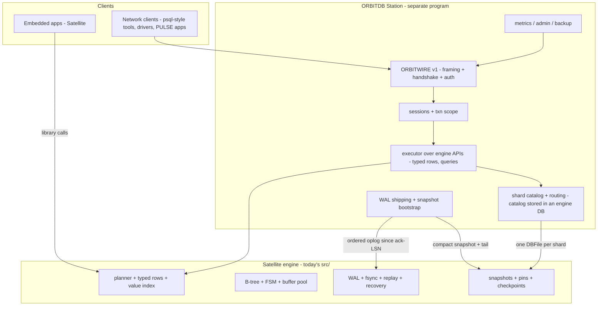

<!-- Copyright (c) 2026 Eleftherios Notas and The XIOM Authors -->
<!-- SPDX-License-Identifier: MIT OR Apache-2.0 -->
# ORBITDB two-tier architecture: Satellite (embedded) + Station (server)

> **Status:** 2026-10-16, planned per owner directive ("plan them ... all in
> same repo"). This document is the strategy for the two-tier product line;
> `docs/PRODUCTION-PLAN.md` section 15 carries the plan-of-record pointer,
> `docs/checklists/two-tier.md` is the execution checklist. Neither tier's
> new work starts before its gates in section 9.

## 1. Vision and naming

**One engine, two products, one repository.**

| Tier | Name | Analogue | Shape |
|------|------|----------|-------|
| Embedded | **orbitdb-satellite** | SQLite | library compiled into the consumer; registry package; single-node |
| Server | **orbitdb-station** | PostgreSQL | separate program: wire protocol, sessions, auth, replication, sharding |

The repository stays `xiom-orbitdb`. Today's engine (`src/`, modules
`xiom.db.*`) **is the Satellite engine** -- the name is a deployment/product
label, not a rename: package and module names stay stable (`xiom.orbitdb`,
`xiom.db.*`). The Station is a new application tier in this same repo
(`station/`) that **consumes the engine as a library and never forks it**.
("satellite" spelling normalized from the owner's shorthand.)

Precedents for the split: SQLite -> libSQL/Turso, DuckDB -> MotherDuck,
ClickHouse's embedded origins. The safe direction is always the same:
embedded core first, server layered on top of the same storage substrate.

**Fleet codename convention (packages lane, `REL-20261016-1446-packages`,
2026-10-16):** tier identity lives in package docs, not registry ids --
registry-tier codenames are Beacon / **Satellite** / mote; standalone-tier
codenames are **Station** / lattice. Our names already match the
convention; registry ids stay unchanged (`xiom.orbitdb` for the embedded
artifact).

## 2. Why this maps onto what already exists

The Station does not need a storage redesign; the substrate facts are in
place:

- **WAL is an ordered oplog** -- LSN resume, Begin/Commit/Abort records,
  torn-tail heal, real fsync at the durability seams. That is the
  log-shipping substrate for replication.
- **Generation-committed incremental checkpoints + the v2 block container +
  migration-on-write** give snapshot bootstrap and shard transfer
  (`block_store_compact` publishes a synced, binary-safe snapshot).
- **Crash recovery is already honest** (torn tail/page tolerant, replay
  gated by `checkpoint_lsn`, uncommitted txn windows discarded) -- the hard
  durability part of a server is done and tested.
- **Composition is proven**: the hybrid probe composes the engine with
  another source tree via source roots; the Station composes the same way
  now and switches to the registry package later.
- **Ecosystem precedents**: `xiom.sqlite` already ships as a registry
  package consumed by PULSE deployments; the packages lane built
  `xiom.postgres` (a pure-XIOM PG wire v3 *client*) -- a ready-made
  test/interop client for the Station's protocol work.
- **Threads exist** in the runtime (stdlib wave 139); the engine is
  single-threaded today, which the Station can initially absorb with a
  single-writer commit path (the WAL append is the natural serialization
  point, exactly as in PostgreSQL).

## 3. Repository layout (target)

```
src/                      SATELLITE ENGINE (xiom.db.*) -- unchanged consumers
apps/orbitdb_cli.xi       Satellite CLI (out/orbitdb.exe)
tests/                    Satellite suite / probes / repro bundles
scripts/                  Satellite runners + harnesses (unchanged)

station/                  STATION (server tier) -- new
  xiom.toml               project manifest (source-roots: ../src + src)
  src/                    xiom.station.* modules
  tests/                  Station suites + protocol conformance
  docs/                   protocol notes (until promoted to docs/FORMATS.md)

docs/                     shared: API.md, FORMATS.md, this document, checklists
```

Rules: the Station only calls **public** engine APIs (`docs/API.md`);
engine changes are additive; the R1/R2 module split of the engine is what
freezes the substrate boundary the Station consumes.

## 4. Target architecture



Data-plane rules:

- **Shard = one engine database** (`DBFile` over its WAL + snapshot). The
  station process opens one handle per shard it serves; shard ownership is
  explicit and file-lock backed.
- **Replication = primary -> replica WAL shipping** since the last
  acknowledged LSN, plus snapshot bootstrap (compact at generation G,
  transfer `.snap` + WAL tail, replica resumes at `checkpoint_lsn`).
  Generation + `checkpoint_lsn` from the snapshot header give the epoch
  handshake; an epoch/term file (with `file_lock`) guards split-brain at
  promotion.
- **Routing = shard key ranges** in a catalog (itself an engine DB);
  scatter-gather for cross-shard reads with pinned ORDER/LIMIT semantics;
  rebalancing = snapshot transfer + tail catch-up.
- **Transactions v1 = single-shard scope** (engine txn window per shard,
  serialized commit path). Cross-shard/2PC is a later tier (section 8).

## 5. Satellite track (what remains for the embedded product)

The Satellite is the current release path -- nothing here forks it:

1. **Gates already planned**: M1.1b pager (lazy node load, random-access
   `read_at`/`write_at`, bounded cache), M3 remainder (cross-process MVCC:
   `file_lock`, pins, version GC), R1/R2 module split, per
   `docs/PRODUCTION-PLAN.md` + `docs/checklists/production-release.md`.
2. **Product labeling at release**: README/SPEC/API gain the
   "ORBITDB Satellite" tier label; module/package names unchanged.
3. **Registry packaging (P-rc)**: when the gates pass and the owner
   green-lights publication, open a **relay item to the packages lane** for
   publishing coordination (packaging assist: scope ask, P-rc recipe,
   canary; ops owns the allowlist gate) -- owner directive 2026-10-16. The
   CLI ships as the satellite front door.
4. **Satellite-only stays simple**: no network code, no server deps, zero
   dependency core preserved.

## 6. Station milestones (ST0..ST7), each with exit criteria

- **ST0 -- prerequisites (gates, no new code):** M1.1b pager, M3 remainder
  (`file_lock` + cross-process pins), R1/R2 split merged, threads decision
  recorded. The Station does not start before these; each is tracked in the
  existing plan/checklist.
- **ST1 -- protocol spike (loopback only):** freeze **ORBITWIRE v1**
  (length-prefixed frames; text + binary rows; handshake with protocol
  version + auth slot; prepare/execute/fetch over the engine's typed-rows
  and query APIs; error taxonomy mapped from `DbError`). Test client built
  in XIOM; interop notes against `xiom.postgres`'s wire knowledge. Exit:
  round-trip conformance suite green x2 both platforms; `docs/FORMATS.md`
  gains the wire section.
- **ST2 -- single-node server core:** one process, one shard, session
  loop, executor, graceful shutdown, kill-safe handle discipline; a station
  crash harness (kill mid-commit -> restart -> replay -> qverify, mirroring
  the engine harness style). Exit: station suite x2 both; crash harness
  green x2 both; no engine file touched.
- **ST3 -- concurrency:** reader snapshots (engine pins) + single-writer
  commit path; decision spike thread-per-connection vs process-per-shard
  (bounded by the ST0 pager cache); isolation documented. Exit: mixed
  reader/writer session harness under churn x2 both; isolation note in
  `docs/ISOLATION.md` (station section).
- **ST4 -- replication:** WAL shipping + snapshot bootstrap + replica read
  mode + promotion with epoch/file-lock guard. Exit: replication harness
  (primary kill -> promote replica -> zero-loss at synced seams, honest
  power-loss semantics) x2 both.
- **ST5 -- sharding:** catalog, range routing, scatter-gather reads with
  pinned ORDER/LIMIT semantics, manual rebalance via snapshot transfer +
  tail catch-up. Exit: local cluster harness (2-4 shards), crash during
  rebalance, x2 both.
- **ST6 -- operations:** minimal auth (users file, hashed secrets; TLS
  when the ecosystem binding lands -- see risks), backup/restore drills,
  metrics endpoint (PULSE metrics/otel packages), connection limits and
  timeouts. Exit: ops runbook section + drill evidence.
- **ST7 -- scale and league:** cross-engine bench vs PostgreSQL on
  identical YCSB-ish ops (embedded league = BENCH-1's harness extended),
  failover drills, soak; publish numbers in the readiness doc.

Optional, evaluated only after ST7: **ST8 -- PG-wire facade** (accept
PostgreSQL's wire protocol for free tooling/drivers, riding the existing
client-side knowledge). Not a v1 commitment.

**Station release engineering (owner directive 2026-10-16):** Station
releases ship through a **GitHub Actions pipeline authored with ops** --
this lane provides the build/test/soak contracts and the pinned-toolchain
recipe; ops owns the pipeline. Registry involvement for the Station is
limited to its future client package (if and when one is published).

## 7. Interfaces and contracts

- Station consumes only public engine APIs; every engine addition it needs
  is additive and lands with suite x2 both per lane rules.
- The wire protocol is versioned like the on-disk formats; format changes
  go through `docs/FORMATS.md` policy.
- Durability contract inherited: no ack before the synced WAL seam; shipped
  LSNs are always <= the last synced LSN (replicas are honestly behind).
- Backups/transfers use binary-safe paths only (RUNBOOK gotcha: never the
  text `copy_file` path on `.snap`/binary artifacts).

## 8. Non-goals and explicit deferrals

- **No full SQL in v1** (typed-rows/query API over the wire; a SQL facade
  can come later, likely as a packages-lane parser).
- **No cross-shard transactions in v1** (single-shard scope, documented).
- **No auto-sharding/auto-failover in v1** (manual catalog, explicit
  promotion; automation is ST7+).
- **No multi-master** anywhere in this plan.
- **Station never blocks the Satellite release**; ST0 gates the start.

## 9. Risks and gates

| Risk | Mitigation |
|------|------------|
| M1.1b slips -> both tiers stall | Keep it first in the task order; it is the keystone for datasets > RAM |
| TLS absent ecosystem-wide (pulse-5 headline) | Station v1 targets trusted networks/local first; ST6 auth ships without remote TLS until the stdlib/packages binding lands |
| Protocol scope creep (PG-wire dreams) | v1 is ORBITWIRE only; PG-wire is an optional ST8, never a base requirement |
| Shared-repo drift between tiers | Station only via public APIs; R1/R2 split freezes the boundary; engine suite must stay green on every station PR |
| Split-brain at promotion | Epoch file + `file_lock` + generation/`checkpoint_lsn` handshake; zero-loss only at synced seams (honest semantics) |
| Single-active txn in engine | Accepted v1: per-shard serialized commit path (same shape as WAL-serialized servers); cross-shard txn deferred |

**Cross-lane wishlists (filed 2026-10-16, so the dependencies are visible
early and batched):**

- **stdlib** -- `REL-20261016-1128-orbitdb`: `file_lock` (hard gate for the
  M3 remainder / G-START), TLS + ALPN server side, TCP session ergonomics
  (NODELAY, half-close, timeouts, multi-listener accept), CSPRNG + password
  KDF, monotonic clock. Overlap with `REL-20261015-2202-pulse` is
  acknowledged there (we defer to PULSE's list for the shared items).
- **packages** -- `REL-20261016-1128-orbitdb-2`: TLS binding (folded with
  PULSE's ask), `xiom.postgres` wire-codec kept reusable for ST1 interop +
  the optional ST8 facade, `xiom.durable` fit check for ST4 log shipping,
  OTLP gauges, real zstd/brotli; plus the early heads-up that the Satellite
  publication will open a coordination item (owner directive).

## 10. Execution checklist

`docs/checklists/two-tier.md` -- the step-by-step, gated checklist for
execution agents (prerequisites first, then ST1..ST7 with evidence rules
mirroring the lane discipline: suites x2 both platforms, crash harnesses
x2 both, probe-logs gitignored, signed conventional commits, docs coupled).
