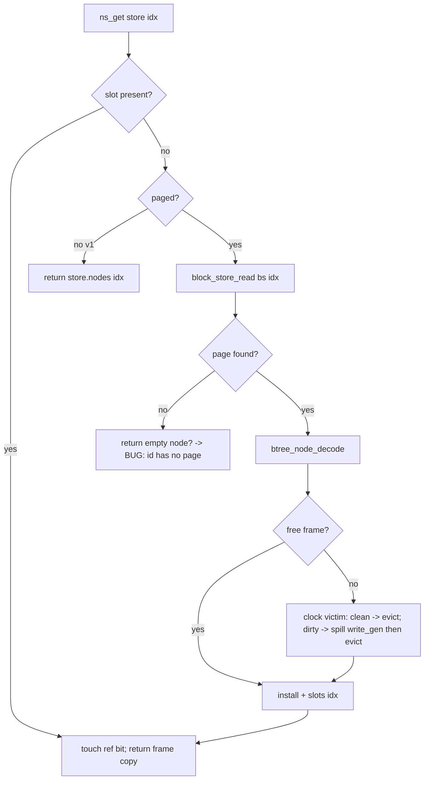
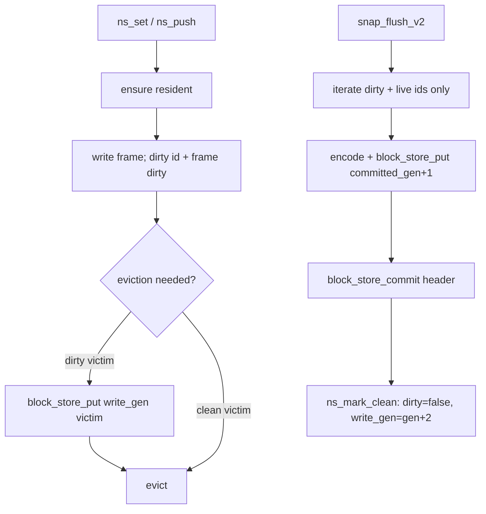

<!-- Copyright (c) 2026 Eleftherios Notas and The XIOM Authors -->
<!-- SPDX-License-Identifier: MIT OR Apache-2.0 -->
# M1.1b -- pager: lazy node load + bounded cache + deferred free

> Design of record for the storage-spine slice (task order #4; G-START gate).
> **Status 2026-10-19: A1-A4 DONE and green on both platforms; A5
> (deferred free) + the A6 soak/BENCH note remain open.**
> References: `docs/REFERENCE-MATRIX.md` sections 1.1-1.3 (re-crawled
> 2026-10-19). Implementation: `src/index/btree.xi` (NodeStore) +
> `src/engine/snapshot.xi` (v2 container integration). Evidence rules: suite
> x2 both platforms, db_crash x2 both, fuzz, probes, crash windows; the
> benchmark rows in `docs/BENCH-1.md` are re-run at the wrap.

## 1. Problem

The 0.2.x tree is fully resident: `snap_load_v2` decodes every committed node
into `NodeStore.nodes`, and every checkpoint keeps an O(n) arena in memory.
The v2 block store already supports random access (`block_store_read` ->
`byteio_read_at`), but the engine never uses it that way after load. Memory
therefore grows with the key count and the Station substrate (lazy pager reads,
cross-process pins, version GC) has no seam to build on.

## 2. Scope and non-goals

**In scope**

- `NodeStore` paged mode over the v2 block store (`paged: Bool`): node ids are
  page ids; `ns_get` loads on miss into a bounded clock cache.
- Dirty frames spill at the uncommitted write generation on eviction
  (`pagerStress` shape); checkpoint publication is still the only commit.
- Deferred free: retired node ids (COW shadows, merged/deleted nodes) are
  omitted from the next checkpoint/compaction once no live pin can reference
  them; ids are never reused in this slice.
- One owned `BlockStore` handle per `NodeStore` so pager spills and checkpoint
  appends share one `block_count` (no dual-handle overwrite).
- New `probe_pager.xi` + `tests/suite/pager.xi`; existing API unchanged.

**Out of scope (later)**

- v1 page-log snapshots stay fully resident (legacy, auto-detected; v2 is the
  default and migration-on-write still applies).
- Reusing freed ids / page-run allocators (redb buddy allocator = avoid row).
- Storing the block directory outside the scan (open stays O(file) until a
  directory footer lands).
- Cross-process pins and `file_lock` (M3 remainder).
- Multi-threaded pager.

## 3. Data structures

```
NodeStore (paged mode; v2)
  count: Int                  // ids 0..count-1 (monotone, never reused)
  paged: Bool                 // false -> v1 resident path
  bs: BlockStore              // owned container handle (v2)
  write_gen: Int              // committed_generation + 1 (spill generation)

  slots: Vec[Int]             // id -> frame, -1 = not resident
  frames: Vec[BTreeNode]      // capacity-bounded cache
  frame_ids: Vec[Int]
  frame_dirty: Vec[Bool]
  frame_ref: Vec[Bool]        // clock second chance
  hand: Int
  capacity: Int

  dirty: Vec[Bool]            // per-id checkpoint dirty set
  births: Vec[Int]            // M3 COW epoch
  live: Vec[Bool]             // false = retired (deferred free)
  pending_free: Vec[Int]
  pending_epoch: Vec[Int]

  pins: Vec[DBSnapshot]       // DBSnapshot gains pin_epoch
  pin_clock: Int
  compaction_deferred: Int
```

Invariants

1. `slots[i] == f` implies `frame_ids[f] == i`, `frames[f]` is live and
   `live[i]` is true.
2. Every dirty id is either in a dirty frame or already spilled at
   `write_gen`; a checkpoint may write it from either location.
3. A dirty frame is never dropped without a successful
   `block_store_put(bs, write_gen, id, bytes)`.
4. `write_gen` only moves forward at checkpoint publication
   (`ns_mark_clean`), never during a transaction.
5. A retired id is released only when no pin with `pin_epoch <=
   pending_epoch[i]` remains; released ids are omitted from compaction.
6. `ns_get` may return an uncached copy when every frame is pinned; callers
   already treat it as a local copy (no in-place mutation).

## 4. Read path



- A committed node's page is immutable while any pin can see it: COW writes a
  new id, and compaction is deferred while pins exist. Loading an evicted
  pinned node therefore returns its committed version.
- Nodes created in this handle are pushed dirty and spill at `write_gen` if
  evicted; `block_store_read` resolves own writes (own-writes-visible), and a
  reopen ignores the uncommitted generation.
- `decode` failure or a missing page for a live id is a corruption error: the
  node is returned as an empty leaf and a `pager_corrupt` counter increments;
  the checkpoint refuses to write a corrupt node (fail-stop beats silent loss).

## 5. Write path and checkpoint



- `snap_flush_v2` takes the owned `tree.store.bs`; it no longer opens a second
  `BlockStore` (single writer to `block_count`).
- The dirty set is per id; a dirty frame that was spilled is still written
  again at checkpoint (idempotent duplicate append; the directory keeps the
  latest generation). Compaction reclaims the duplicates.
- `db_file_checkpoint` / `maybe_checkpoint` semantics do not change: WAL
  flush first, header commit, then `ns_mark_clean`.
- `snap_load_v2` builds the paged store from the committed header
  (`node_count`, `root`) and does not decode any node until first access.
  `SnapFormat::V1` keeps the resident path.

## 6. Deferred free

**As built (A5, 2026-10-19).**

- Retire points: `cow_shadow` (old id), `split_root` (old root),
  `merge_children` (folded right child + collapsed root). Retire records
  `pending_epoch = pin_clock` and `live[id] = false`. **Dirty is NOT cleared**
  on retire: a conservative retire must never suppress a flush. Retired ids
  keep their page valid until GC.
- `ns_release_pending(store)` runs at `db_file_snapshot_end` (via
  `btree_release_pending(&mut db.tree)` — a 3-level `&mut db.tree.store`
  would copy under C-ORBIT-13) and after checkpoint commits: release ids
  whose `pending_epoch < min(active pin_epochs)` (or all when no pins).
- GC compaction (`v2_rewrite_all` for a paged tree with no pins): BFS from
  the live root, dense id remap, write only reachable nodes, commit, rename,
  `ns_reset_paged`. Reachability — not the `live` hint — decides what is
  dropped, so a wrong retire cannot lose a reachable node.
- `NodeStore.dirty.len()` / metadata remain O(n) (bool + int vectors); the
  node STRUCTS are the bounded part. A 1M-node tree keeps ~24-32 MB of
  metadata, well below the full arena.

## 7. Execution checklist

- [x] **A1 -- accessor-only refactor.** Replace all 47 direct
  `tree.store.nodes[idx]` reads with `ns_get(&tree.store, idx)`; keep the
  resident implementation. Suite x1 both; no behavior change.
- [x] **A2 -- node codec move.** Move `SNAP_NODE_HEADER_BYTES`,
  `snap_node_page_bytes`, `snap_decode_node` from `engine/snapshot.xi` to
  `index/btree.xi` (`btree_node_*`); snapshot calls the new names. Suite x1.
- [x] **A3 -- paged NodeStore.** Add `paged/bs/write_gen/slots/frames/...`;
  `ns_get/ns_set/ns_push/ns_len/ns_mark_clean` implement the read/write/spill
  paths. Keep `ns_new` resident default; add `ns_new_paged(bs, root, count,
  capacity)`. Suite x2 both + probe_pager (correctness + bounded counters).
- [x] **A4 -- snapshot integration.** `snap_load_v2` creates the paged store;
  `snap_flush_v2` uses `tree.store.bs` and writes dirty+live ids only;
  compaction skips retired ids. Crash windows: spill not committed after a
  kill is ignored; committed checkpoint replays exactly. Win suite 160/160
  x2; keys 1..8 survive the second checkpoint/reopen. **C-ORBIT-13:**
  &mut tree.store.bs (3-level path) copies -- use a local + write-back
  (workaround landed). WSL suite + db_crash pending.
- [x] **A5 -- deferred free.** Retire points + `ns_release_pending` + pin
  epochs; probe asserts live count drops after checkpoint/compaction and
  snapshot reads stay exact. Suite x2 both + MVCC probe x2.
- [~] **A6 -- evidence + docs.** Battery green (suite 164/164 x2 both, crash 25/25 x2 both, probes/fuzz/hybrid). **Soak: 15k green; 200k RED on memory (relay `REL-20261019-2206-orbitdb`); 1M blocked** until the per-I/O allocation retention is fixed. BENCH memory row pending. probe_pager + suite pager coverage; update
  ARCHITECTURE (NodeStore contract), MVCC (pin epochs), READINESS changelog;
  BENCH-1 memory note (bounded cache) and a soak at the wrap. Suite x2 both,
  crash x2 both, fuzz, hybrid guard.

## 8. Risks / open questions

- **Coverage of the accessor refactor**: one missed direct read only fails in
  paged mode when the node is evicted; probe_pager uses capacity 4 over a
  ~500-node tree so misses are guaranteed. Compile-time review: remove the
  `nodes` field from the paged path? (Keep for v1; grep is the guard.)
- **Dirty working set > capacity**: every mutation can dirty a new frame;
  spills bound memory but grow the log. The compaction threshold
  (`node_count + SNAP_COMPACT_SLACK`) still bounds file growth; a churn soak
  measures spill amplification.
- **Open scan cost**: `block_store_open` remains O(file); a directory footer
  is the next slice if open latency matters.
- **Savepoint page rollback**: recorded in the matrix row but not implemented
  here; savepoints already roll back the txn buffer. Page-side restore is
  deferred to the M3 remainder (documented, not silently dropped).
- **v1 coverage**: lazy load is v2-only; v1 remains resident and is
  auto-detected/migrated. The suite pins both formats.
