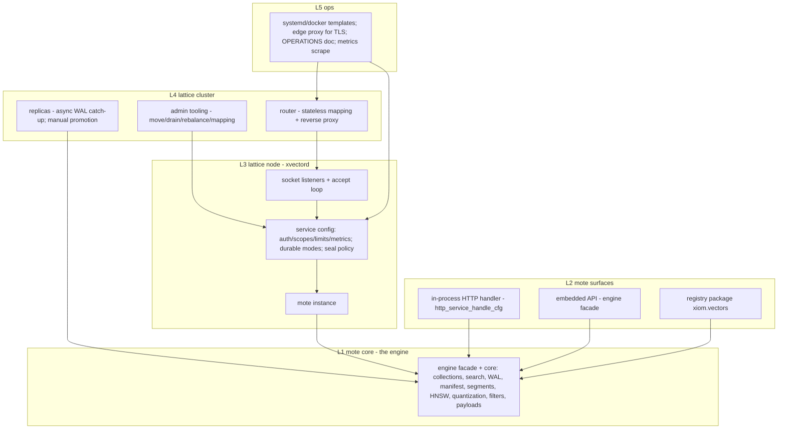
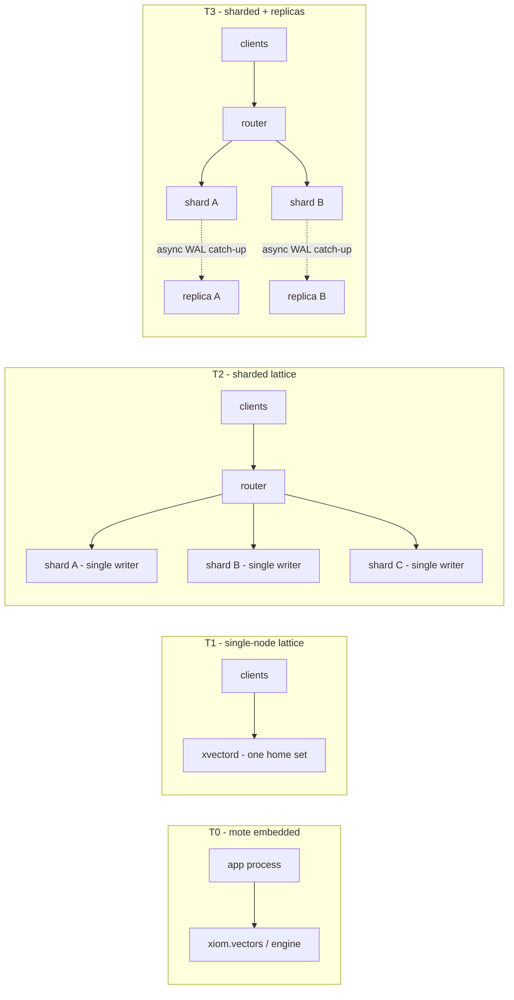
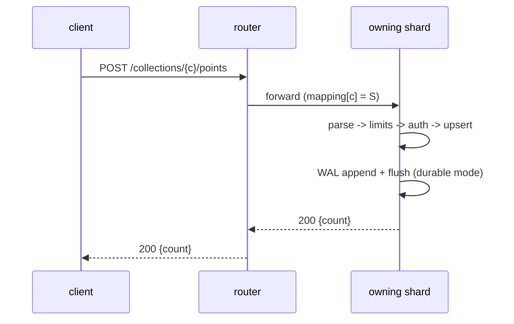

<!-- Copyright (c) 2026 Eleftherios Notas and The XIOM Authors -->
<!-- SPDX-License-Identifier: MIT OR Apache-2.0 -->

# XVECTOR product architecture -- mote / lattice (plan v1)

Status: **plan**, 2026-10-16 (owner-directed; pairs with
`docs/PRODUCT-LAYERS.md` -- the naming decision). Execution checklist:
`docs/checklists/lattice-v1.md`. This plan adds NO code slices by itself;
each slice lands under the lane's gate discipline (suite x2 + probes x2 +
batteries + WSL spot, signed commits, docs updated).

## 1. Principles (normative)

- **P1 -- One engine.** Both tiers run the same `src/` tree. A lattice
  node IS a mote plus transport, cluster wiring, and ops.
- **P2 -- One on-disk format.** A home = manifest + WAL + segments
  (+ snapshots). Files are portable across tiers and machines; there is
  never a migration step between "embedded" and "served".
- **P3 -- Single-writer per home (shard).** All ordering guarantees stay
  the engine's: WAL-before-ack, atomic manifest switch, tombstone
  shadowing. No multi-writer shards, no cross-shard transactions.
- **P4 -- Stateless routing.** The router holds a mapping, never data
  state; any router instance can serve any request; restart-safe.
- **P5 -- Exactness first.** v1 shards by collection (results are exact
  by construction). Intra-collection scatter-gather lands only behind an
  exactness/recall gate (L-6); partial results are opt-in and flagged in
  the response. No silent degradation, ever.
- **P6 -- Gates per slice.** Every slice below carries probes/batteries;
  the existing 177-check suite + 45 probes are the floor.

## 2. Layer map



## 3. What exists vs what is new

| Piece | Status |
|---|---|
| Engine core (flat + HNSW, metrics, filters, payloads, SQ/PQ, WAL, manifest, segments, snapshots, kill recovery, memory estimate) | **exists** (D 95, readiness 88 %) |
| Embedded API + in-process HTTP handler + `xiom.vectors` package (live, backs all consumers) | **exists** |
| `xvectord` node: listeners, durable modes, seal policy, auth/limits/metrics, `/health` `/version` `/collections` `/collections/{c}/points` `/search` `/stats` | **exists** (flags: `XVECTORD_BIND/PORT/MANIFEST/WAL/CHECKPOINT_EVERY/SEAL_EVERY/SEAL_DIR`) |
| Registry (collections), per-collection routing, self-describing manifests | **exists** (M-D2/M-D3) |
| Checkpoint/compact+swap, roll/seal, union reads, compaction | **exists** (D5-D7) |
| **Collection move primitive** (freeze -> flush -> copy -> attach -> flip) | **new** (L-2) |
| **Router v1** (stateless mapping file + reverse proxy + retry) | **new** (L-3) |
| **Replica v1** (async WAL catch-up, lag metric, manual promotion) | **landed v1** (L-4; file-ship catch-up + manual promotion runbook) |
| **Drain/rebalance CLI + cluster ops docs** | **new** (L-5) |
| **Intra-collection scatter-gather + ranked merge** | **new** (L-6, phase B) |
| TLS on the wire | ecosystem gap; edge proxy until the FFI binding lands |

## 4. Deployment topologies



- **T0/T1 ship today** (modulo polish). T2 is the v1 scale-out target;
  T3 adds async replicas (manual promotion in v1).
- Shards are ordinary `xvectord` processes with disjoint homes. The
  router is the only new moving part in T2.

## 5. Data and format model (unchanged)

- Home layout: `manifest` (collection registry + per-collection refs) +
  per-collection WAL + segment files (active + sealed) + snapshots.
- Segment v2 carries optional SQ codes (Q-a); sealed segments are
  immutable; compaction preserves tombstones/bytes bit-exactly. Since
  L-2 every persisted segment appends a `z <count> <crc32>` integrity
  footer (old loaders ignore it; attach requires it).
- **The portable move unit is ONE segment file** (self-contained: meta +
  vectors + payloads + graph + SQ codes + footer). Moving a collection =
  `export_collection` (durable roll on the source; the source keeps
  serving through its sealed entry) -> file copy -> `create_named_collection`
  + `attach_segment` on the destination -> verify -> `drop_collection` on
  the source. The manifest entry is recreated on attach (fresh cid), not
  transported. v1 scope: no pre-existing sealed segments on the source
  (L-5 adds compaction-aware moves + the drain CLI).

## 6. Request paths

### 6.1 Write (server tier)



- Mapping miss -> the router aggregates `GET /collections` from known
  shards only at startup/refresh, never per request (see 9).

### 6.2 Read / search (T2, collection-level = exact)

Same as 6.1: the request is routed to the single owning shard; results
are exact by construction (no merge).

### 6.3 Intra-collection scatter-gather (L-6, phase B only)

```mermaid
sequenceDiagram
  participant C as client
  participant R as router
  participant S1 as shard 1..N
  C->>R: POST /search {collection, vector, top_k, filter}
  R->>S1: fan-out (same body; filter pushed down)
  S1-->>R: top-k' hits (k' = k * oversample)
  R->>R: k-way merge (distance asc, id asc; id tiebreak)
  R->>R: apply offset/limit AFTER merge (rank semantics)
  R-->>C: 200 {hits} (+ "partial": flag only in partial mode)
```

- Merge is exact for Flat per-shard results (k-way of per-shard total
  orders == global order when k' >= rank window needed).
- HNSW per shard stays approximate: recall bound is measured by the L-6
  gate; oversampling factor is a config knob, defaulted by that gate.

## 7. Consistency and failure model

| Scenario | Behavior |
|---|---|
| Writer shard down | strict mode: 503 with per-shard report; partial mode (opt-in): live-shard results + `"partial": true` |
| Router down | stateless: run N routers behind the edge; any instance serves |
| Stale mapping (after a move) | shard answers 404; router re-reads the mapping (versioned) and retries once; clients see a normal response |
| Torn WAL tail | recovery returns the longest valid prefix (existing engine guarantee) |
| Half-written manifest | atomic temp+rename; never observable (existing) |
| Replica lag / promotion | lag exposed as a metric; promotion is MANUAL in v1: stop writer -> replay to frontier -> flip mapping (mapping version bump) |
| Split-brain | v1: the mapping has a single writer (admin tooling); a shard never serves a collection it does not own after a flip (404). Auto-failover is a non-goal for v1 |

## 8. Scaling model

- **v1 (exact): shard by collection.** Shard count sized by
  tenant/collection; a single hot collection scales vertically first
  (HNSW params, SQ/PQ, mmap-backed segments, more RAM).
- **phase B (L-6): shard a huge collection** by ID range or hash
  (decision recorded in the L-6 design; range keeps scan/pagination
  cheap, hash evens load). Ranked-merge semantics per 6.3; pagination
  (`offset`/`after_id`) computed after the merge.
- **Rebalancing = moving collections** (L-2 primitive): freeze -> final
  WAL flush/checkpoint -> copy dir + manifest entry -> attach -> flip
  mapping version. No re-hash, no data rewrite in v1 semantics.
- **Cluster snapshot** = per-shard snapshots + the mapping version (no
  cross-shard transactions; restore = restore each shard, then the
  mapping).

## 9. Cluster metadata and routing (v1)

- **Mapping file** (JSON): `{version, shards: [{id, url}...],
  collections: {name -> shard_id}}` + a generation counter. Owned by
  admin tooling; read by routers (poll + reload; optional push later).
- Router refresh: on startup, on file change, and on a shard 404 retry.
- New-collection placement: admin policy (explicit or least-loaded by
  `mem_*`/`/stats`); recorded in the mapping, then the shard creates it.
- The router exposes `/health` (itself) and an aggregate `/stats` (sum
  of shard stats + mapping version) on the admin scope.

## 10. API surfaces

- **Embedded (mote):** the current engine facade + `http_service_handle_cfg`
  used in-process (no socket). Optional `mote` CLI (open/search/bench)
  in L-1 polish.
- **Wire (lattice):** the current route set is the contract, unchanged:
  `GET /health`, `GET /version`, `GET|POST /collections`,
  `POST /collections/{c}/points`, `GET|DELETE /collections/{c}/points?id=`,
  `POST /search` (knn/range/batch), `GET /stats`, `GET /metrics`;
  auth scopes + limits config as today.
- **Router additions (admin scope):** `GET /cluster/mapping`,
  `POST /cluster/move {collection, to}` (L-5 drives the L-2 primitive),
  `GET /cluster/stats`.
- **Client compatibility:** the same HTTP client works against a single
  node or a router; the router hides topology.

## 11. Security posture

- Now: API keys + scopes (read/write/admin), request limits, per-shard
  home isolation. Auth applied at the router AND at shards (defense in
  depth; shards are internal-only on the network).
- TLS: edge proxy terminates (PULSE roadmap owns the binding); direct
  TLS is blocked on the ecosystem FFI work. Documented as the one
  enterprise-serving gap.

## 12. Slice plan (details in `docs/checklists/lattice-v1.md`)

Reference input: `docs/REFERENCE-STUDY-04-LATTICE.md` (bbolt/redb/
sqlite-vec/ann-benchmarks/zstd mechanics per slice, with traps).

- **L-0** naming + plan docs (this commit). Gate: docs reviewed.
- **L-1** mote polish: quickstart (open home -> upsert -> search,
  embedded), optional `mote` CLI, docs. Gate: quickstart example probe
  in CI + docs.
- **L-2** collection move primitive + CLI. Gate: move a collection
  between homes; search/stats bit-exact across the flip; interruption
  (kill during copy) leaves both sides consistent.
- **L-3** router v1 (mapping file, reverse proxy, retry-on-404). Gate:
  2-shard probe (multi-collection ops through the router == direct),
  routing fuzz, stale-mapping retry probe.
- **L-4** replica v1 (async catch-up, lag metric, manual promotion).
  Gate: kill matrix with a replica (acked writes survive writer kill
  after promotion; lag returns to 0).
- **L-5** drain/rebalance + cluster ops docs. Gate: move during load;
  no acked write lost; documented brief error window.
- **L-6** intra-collection scatter-gather (phase B). Gate: exactness vs
  single-node ground truth (Flat equal result sets), HNSW recall bound,
  offset/after_id semantics probe.
- **G-2** (in-process concurrency, `XVECTORD_THREADS`) proceeds in
  parallel where the compiler fixes allow; it is orthogonal to T2.

## 13. Non-goals (v1)

Cross-shard transactions; automatic failover; multi-writer shards;
sub-collection rebalancing; GPU; tiered/object storage; cross-shard
filters spanning collections (clients fan out).

## 14. Risks / open questions

- **TLS** (ecosystem) gates direct enterprise serving; edge now.
- **Replication ship shape:** confirm the WAL frontier/sequence exists
  for catch-up (L-4 design starts by pinning this against the actual
  WAL records; fallback = snapshot + tail replay). Reference study 04
  (sqlite reader-frontier snapshot) is the model; `xiom.os.event.poll`
  (real since wave 143) is available for event-driven tails.
- **Mapping staleness window** during moves is client-visible as a
  single retry; document the exact window in L-5.
- **Filtered scatter-gather** can need higher oversampling with
  selective filters; the L-6 gate measures the factor and must name the
  recall definition per arm (ID-set vs distance-threshold; study 04).
- **Homes/replicas on shared/network filesystems: unsupported** --
  sqlite documents WAL as unsafe there (transient shared-memory index);
  ops rule = local disks only (document at L-5).
- **Manifest/checkpoint hardening candidates** (study 04): checksummed
  manifest entry + a recovery-required bit (catch half-attached
  registries on open); checkpoint salt rotation to prevent old/new
  record mixing after a crash.
- **XVC-C-16/C-17** (compiler lane, open) currently gate the v0.64.5
  re-pin and the shared-handle pattern; neither blocks L-1/L-2.
